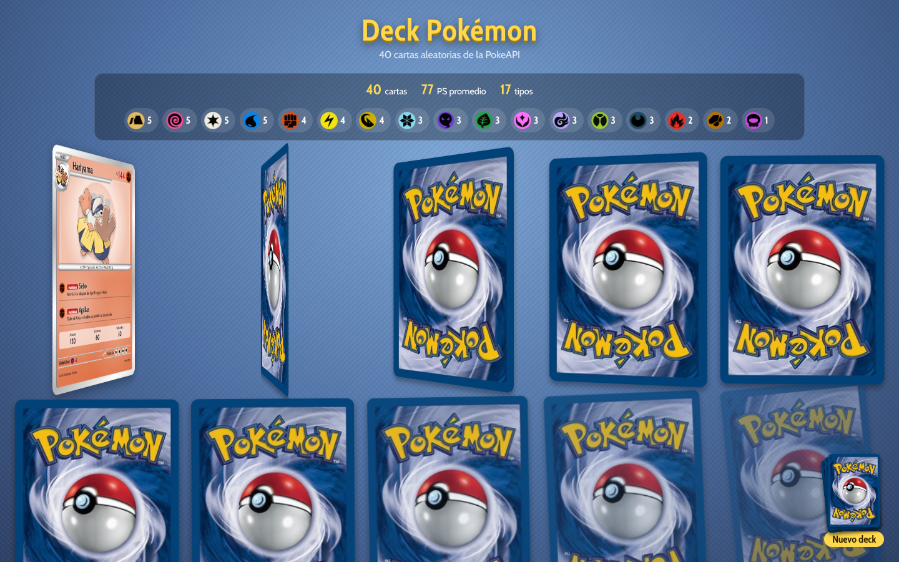
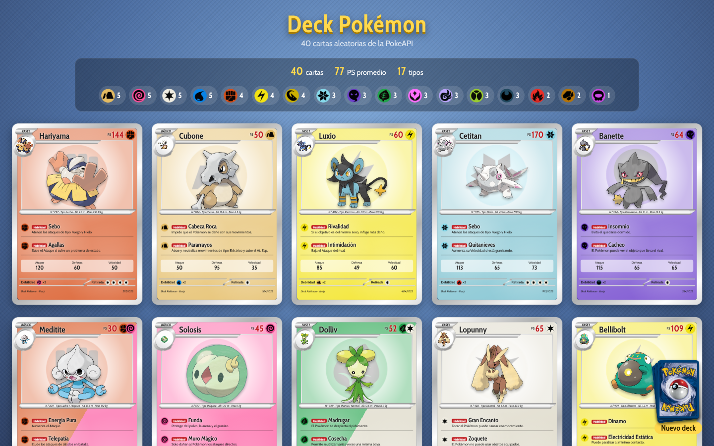
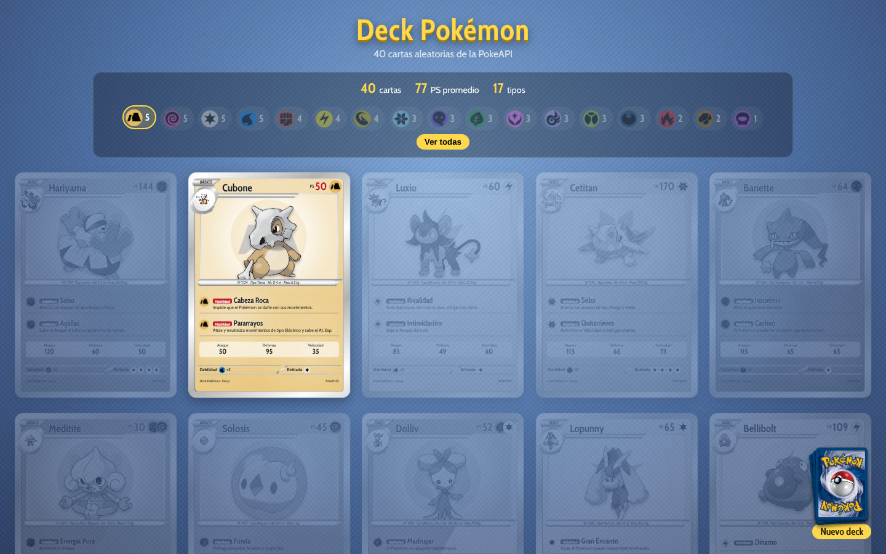
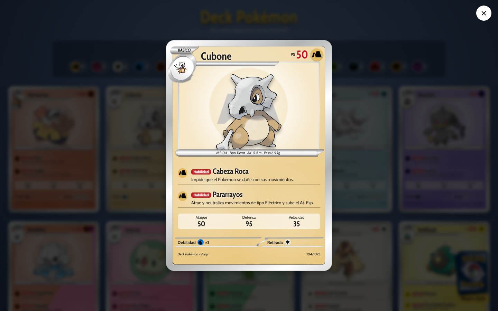

# Deck Pokémon

Deck de **40 cartas Pokémon aleatorias** hecho con **Vue 3 + TypeScript** que consume la [PokeAPI](https://pokeapi.co/).

**Ver en línea:** https://axel00000000.github.io/21160818_VeraOjoseA_Deck_Pokemon/

**Alumno:** Jose Axel Vera Ortiz · 21160818
**Materia:** Servicios Web · Instituto Tecnológico de Oaxaca

## Capturas

| Reparto de cartas | Deck completo |
| :---: | :---: |
|  |  |

| Filtro por tipo | Carta en grande |
| :---: | :---: |
|  |  |

## Qué hace

- Genera **40 Pokémon aleatorios sin repetir** (de 1025) y los pide a la PokeAPI con **axios** y `Promise.all`.
- Cada carta es el componente **`CartaPokemon`** y muestra:
  - nombre en español, número (ID), etapa (Básico, Fase 1 o Fase 2) y PS
  - ilustración oficial y sprite en pixeles
  - tipos con su icono; si tiene 2 tipos, el fondo de la carta se divide en sus dos colores
  - **2 habilidades** con su nombre y descripción en español
  - características: ataque, defensa, velocidad, altura y peso
  - debilidad y retirada
- Las cartas se **reparten boca abajo y se voltean** una por una.
- **Resumen del deck:** cartas por tipo y PS promedio. Al dar clic en un tipo se resaltan sus cartas.
- Al dar clic en una carta se abre **en grande**.
- El **mazo** de la esquina reparte un deck nuevo.

## Estructura

```
src/
├── App.vue                    # Pide los datos a la PokeAPI y arma la mesa
├── components/
│   ├── CartaPokemon.vue       # Una carta
│   └── ResumenDeck.vue        # Resumen y filtro por tipo
├── types/pokemon.ts           # Tipos de TypeScript
└── utils/tipos.ts             # Nombre, color, icono y debilidad de cada tipo
public/
├── marco.png                  # Marco de la carta (diseño propio)
├── reverso.png                # Reverso de la carta
└── tipos/                     # Iconos de los 18 tipos
```

## Cómo correrlo

Requiere Node.js 22.18 o más reciente.

```sh
npm install
npm run dev
```

Abrir http://localhost:5173

## Publicación

Se publica solo en GitHub Pages con la acción de `.github/workflows/deploy.yml` cada vez que se hace push a `main`.
